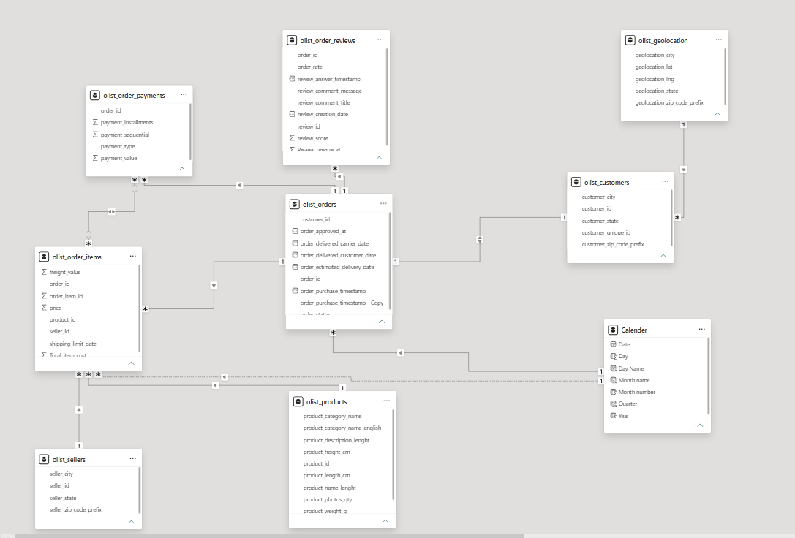
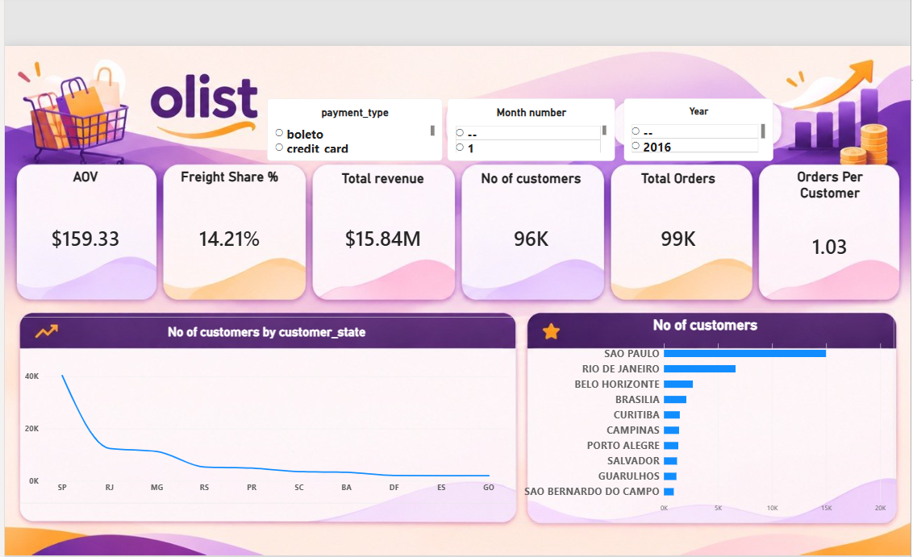
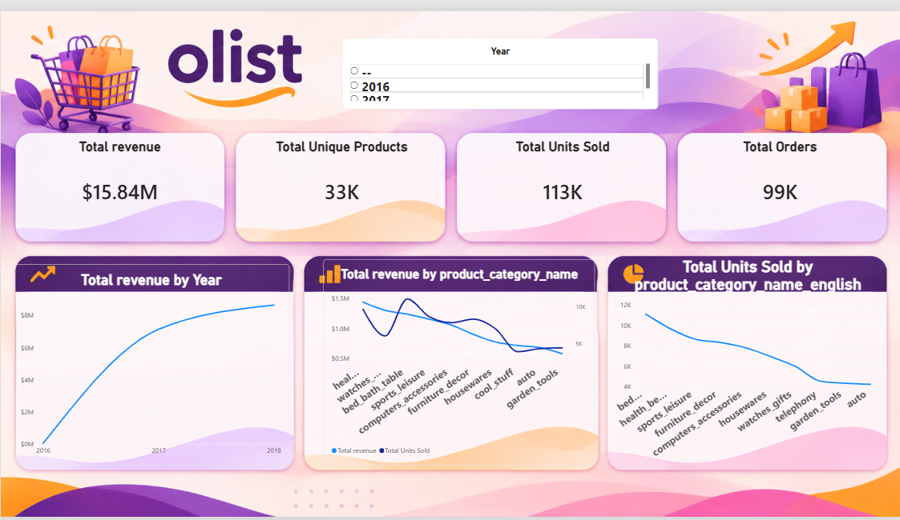
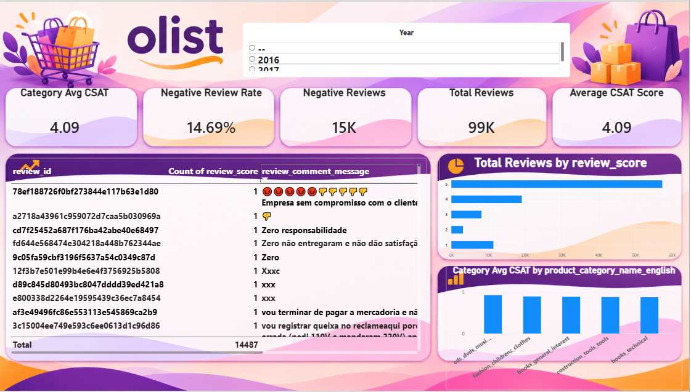
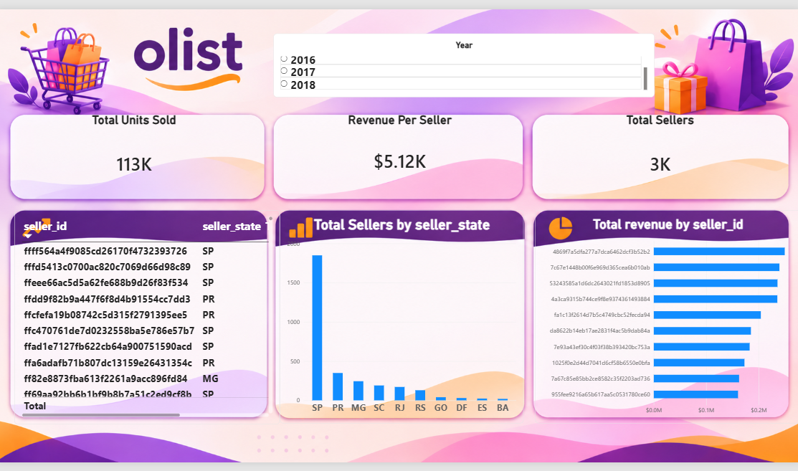
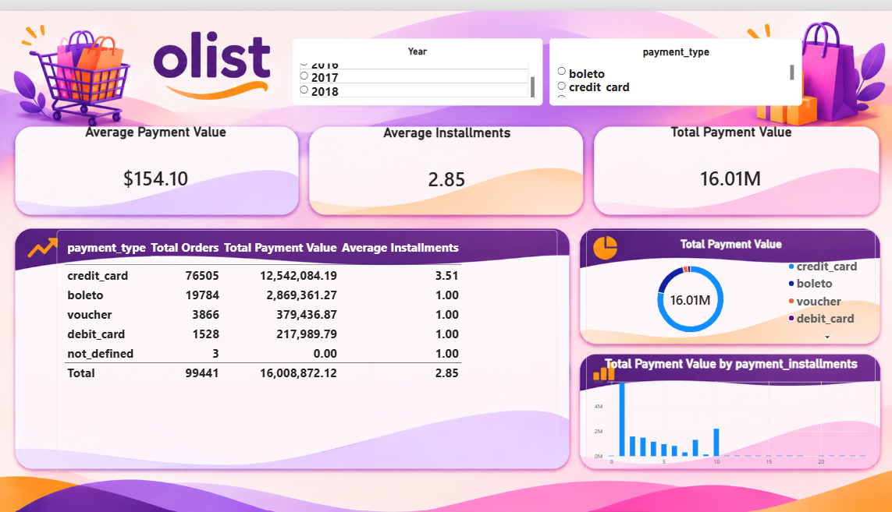

#  Olist E-Commerce Performance & Customer Satisfaction Analysis (Power BI)

##  Project Overview
An end-to-end Business Intelligence project analyzing **99K+ orders** and **$15.84M in total revenue** across the Olist Brazilian E-Commerce marketplace[cite: 1, 2]. The dashboard is structured across **5 interactive domain pages** to uncover revenue drivers, product category dynamics, customer satisfaction bottlenecks, seller concentration, and payment behaviors[cite: 1, 2, 3, 4].

---

##  Data Modeling & Technical Execution
* **Star Schema Architecture:** Modeled relational tables (`orders`, `order_items`, `order_products`, `sellers`, `order_payments`, `order_reviews`) connected to a dedicated `Calendar` dimension table.
* **Advanced DAX Measures:** Built custom measures utilizing `CALCULATE`, `DISTINCTCOUNT`, and `CROSSFILTER(..., Both)` to accurately evaluate category-level CSAT scores (`Category Avg CSAT`)[cite: 2, 3] and seller performance metrics[cite: 4] without double-counting.

---

## 💡 Key Analytical Insights
1. **Accelerated Run-Rate Growth:** 2018 achieved the highest unit volume (113K units sold) and revenue despite missing data for the final 4 months—demonstrating strong month-over-month momentum[cite: 2].
2. **Core Category Stability:** The top 4 product categories remained consistent across years while expanding their revenue contribution, indicating demand anchored by core categories rather than temporary spikes[cite: 2].
3. **The CSAT vs. Revenue Paradox:** Cross-analyzing product sales with customer reviews (4.09 Avg CSAT | 14.69% negative rate) revealed that the highest-rated categories are not among the top 10 revenue generators—highlighting an untapped opportunity to scale high-satisfaction products[cite: 2, 3].
4. **Payment & Installment Behavior:** Single-installment payments drive the highest payment volume (combining 1x credit cards, boleto, and vouchers), while credit cards overall account for over 78% of total payment value ($12.54M out of $16.01M) with an average of 3.51 installments.
5. **Geographic & Logistics Impact:** Both customer demand and seller supply heavily concentrate in São Paulo (`SP`)[cite: 1, 4], which maintains stronger satisfaction scores compared to distant states (e.g., `RJ`) where polarized 1-star reviews are driven by delivery delays[cite: 3].

---

## 🎯 Strategic Recommendations
* **Scale High-CSAT Categories:** Launch targeted promotions and homepage placements for top-rated, mid-volume categories to convert customer satisfaction into top-line revenue[cite: 2, 3].
* **Protect Core Revenue Pillars:** Monitor inventory availability and seller SLA compliance across the top 4 core categories[cite: 2, 4].
* **Optimize Last-Mile Logistics:** Audit shipping carriers and delivery lead times in lower-CSAT states (`RJ`) to reduce delivery-related 1-star reviews[cite: 3].

---

##  Dashboard Pages Preview

### 1. Executive Overview

### 2. Products & Sales Analysis

### 3. Customer Reviews & CSAT

### 4. Sellers & Performance

### 5. Payments & Installments

---

## 📂 Project Deliverables
* **[Download Interactive Power BI Report (.pbix)](https://drive.google.com/file/d/1HGz6UP0p1efTpVaIb_keVtL1mUnwjDwC/view?usp=sharing)** – Full source file for Power BI Desktop.
* `Olist_Dashboard_Report.pdf` – High-resolution export of all 5 dashboard pages[cite: 1, 2, 3, 4].
* `images/` – Clean visual exports of all 5 dashboard views and the data model[cite: 1, 2, 3, 4].
